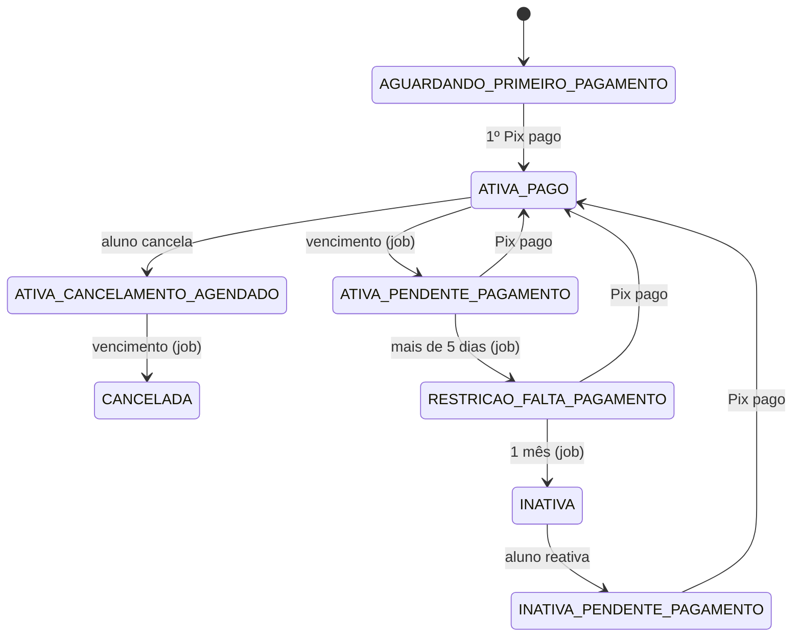

# 🏋️ Academia API


API REST desenvolvida com Spring Boot para gerenciamento de academias, com controle de alunos, planos, matrículas, personais, treinos, exercícios e loja de produtos, cobrança recorrente de mensalidade via Pix, listagens paginadas, autenticação via JWT e RBAC.

## 📑 Sumário

- [Tecnologias](#-tecnologias)
- [Arquitetura](#-arquitetura)
- [Módulo de Pagamentos e Webhooks](#-módulo-de-pagamentos-e-webhooks)
- [Cobrança Recorrente de Mensalidade](#-cobrança-recorrente-de-mensalidade)
- [Módulo de Loja](#️-módulo-de-loja)
- [Controle de Acesso (RBAC)](#-controle-de-acesso-rbac)
- [Como Executar](#️-como-executar)
- [Variáveis de Ambiente](#-variáveis-de-ambiente)
- [Primeiro Acesso](#-primeiro-acesso)
- [Testes Unitários](#-testes-unitários)
- [Documentação da API](#-documentação-da-api)
- [Roadmap](#️-roadmap)
- [Autor](#-autor)

## 🚀 Tecnologias

**Backend:** Java 21, Spring Boot 3, Spring Data JPA, Hibernate, Spring Validation, PostgreSQL, Flyway, MapStruct, Lombok, Maven

**Pagamentos & Integrations:** Mercado Pago Java SDK, Webhooks, Pix (EMV + QR Code), Spring Scheduling (jobs), Spring Mail (SMTP)

**Segurança:** Spring Security, JWT, BCrypt, RBAC

**DevOps & Containers:** Docker, Docker Compose

**Documentação:** SpringDoc OpenAPI 3, Swagger UI

## 🏛️ Arquitetura

```
Controller → DTO → Service → Mapper (MapStruct) → Entity → Repository → PostgreSQL
```
* **Clean Architecture & Design Patterns:** Uso do padrão **Adapter / Strategy** para gateway de pagamentos (`PixGateway` e `MercadoPagoPixAdapter`), desacoplando o domínio das bibliotecas externas e facilitando a troca de provedores de pagamento.
* **Tratamento de Erros:** Centralizado via Global Exception Handler, com exceptions customizadas (`ResourceNotFoundException`, `BusinessException`, `UnauthorizedException`) e validações padronizadas de DTOs.
* **Auditoria de Dados:** Implementada de forma global através de uma `@MappedSuperclass` (`BaseEntity`) integrada ao **Spring Data JPA Auditing**, garantindo rastreabilidade automatizada de criação e modificação (`created_at`, `updated_at`, `created_by`, `updated_by`) em todas as entidades principais.
* **Jobs agendados:** Rotinas recorrentes (cobrança de mensalidade) executadas via Spring Scheduling, com processamento isolado por matrícula.

---

## 💳 Módulo de Pagamentos e Webhooks

A aplicação conta com um fluxo completo e automatizado de processamento de pagamentos via **Pix**:

### 🔄 Fluxo de Pagamento e Ativação

1- Cliente solicita matrícula ➔ API gera cobrança Pix no Mercado Pago (Pagamento: `PENDENTE`, Matrícula: `AGUARDANDO_PRIMEIRO_PAGAMENTO`, sem acesso)

2- Cliente efetua o pagamento no app do banco

3- Mercado Pago notifica a API ➔ `POST /api/webhooks/mercadopago` (notificação assíncrona)

4- API valida o pagamento na gateway ➔ altera Pagamento para `PAGO` e a Matrícula para `ATIVA_PAGO`

5- Aluno escolhe o dia de vencimento (obrigatório) ➔ a partir daí o ciclo mensal passa a ser cobrado automaticamente

* **Idempotência e Segurança:** Validação direta na SDK da gateway a cada notificação para evitar cobranças duplicadas e garantir a integridade do status.
* **Acesso Público Restrito:** Endpoint de Webhook liberado no Spring Security exclusivamente para callbacks da provedora de pagamentos.

---

## 🔁 Cobrança Recorrente de Mensalidade

A mensalidade é cobrada automaticamente por um job agendado (`CobrancaRecorrenteJob`), que roda **todos os dias às 03:00 (America/Recife)**. A cada vencimento é gerado um novo Pix, enviado por e-mail ao aluno. O estado da matrícula é controlado por `MatriculaStatusEnum`.

### 📊 Estados da Matrícula

| Status | Acesso | Descrição |
| :--- | :---: | :--- |
| `AGUARDANDO_PRIMEIRO_PAGAMENTO` | ❌ | Matrícula criada, primeiro Pix ainda não pago |
| `ATIVA_PAGO` | ✅ | Em dia |
| `ATIVA_CANCELAMENTO_AGENDADO` | ✅ | Pediu cancelamento: usa até o vencimento, que não gera nova cobrança |
| `ATIVA_PENDENTE_PAGAMENTO` | ✅ | Venceu e está nos 5 dias de carência; cobrança enviada |
| `RESTRICAO_FALTA_PAGAMENTO` | ❌ | Passou da carência sem pagar; pode pagar e voltar por até 1 mês |
| `INATIVA` | ❌ | 1 mês bloqueado sem pagar; cobrança antiga anulada |
| `INATIVA_PENDENTE_PAGAMENTO` | ❌ | Aluno inativo decidiu voltar; aguardando o novo Pix |
| `CANCELADA` | ❌ | Cancelamento voluntário concluído |



### ⚙️ Etapas do Job

| Etapa | Condição | Resultado |
| :--- | :--- | :--- |
| Vencimento | `ATIVA_PAGO` com `dataVencimento` ≤ hoje | Aplica plano agendado (se houver), gera Pix, envia e-mail ➔ `ATIVA_PENDENTE_PAGAMENTO` |
| Cancelamento | `ATIVA_CANCELAMENTO_AGENDADO` com vencimento ≤ hoje | `CANCELADA` (sem nova cobrança) |
| Bloqueio | `ATIVA_PENDENTE_PAGAMENTO` há mais de 5 dias | `RESTRICAO_FALTA_PAGAMENTO` (registra `dataBloqueio`) |
| Inativação | `RESTRICAO_FALTA_PAGAMENTO` há 1 mês ou mais | `INATIVA` e cobranças pendentes canceladas (banco e gateway) |

* **Ordem de execução:** do estágio mais avançado para o mais inicial, então cada matrícula avança no máximo uma etapa por execução.
* **Isolamento de falhas:** cada matrícula é processada em transação própria; uma falha (ex.: gateway fora) não derruba as demais e é retentada no dia seguinte.
* **Ciclo ancorado:** pagar em atraso não desloca o vencimento; o próximo é sempre a data original + duração do plano.
* **E-mail:** a cobrança é enviada por SMTP (HTML com QR Code e Pix copia e cola). Falha no envio não desfaz a cobrança já gerada.

---

## 🛍️ Módulo de Loja

Além da gestão da academia, a API possui uma loja para que os alunos comprem produtos (suplementos, acessórios, etc.).


### 🔗 Relacionamentos

```text
Aluno ─────► Pedido ─────► ItemPedido ◄───── Produto
```

* Um **aluno** pode realizar vários **pedidos**.
* Um **pedido** é composto por um ou mais **itens**.
* Cada **item** referencia um **produto** e guarda a `quantidade` e o `preco_unitario` do item.
* O status do pedido é controlado por `StatusPedidoEnum` e a forma de pagamento por `MetodoPagamentoLojaEnum`.
### 🗄️ Banco de Dados

* Tabelas `produtos`, `pedidos` e `itens_pedido` criadas via Flyway.
* Índices em `pedidos(aluno_id)`, `itens_pedido(pedido_id)` e `itens_pedido(produto_id)` para otimizar consultas por aluno e por pedido.
  📖 Campos, tipos e SQL completos em [`docs/ENTIDADES.md`](docs/ENTIDADES.md)

---

## 👥 Controle de Acesso (RBAC)

| Role | Permissões resumidas |
|---|---|
| `SUPER_ADMIN` | Acesso total ao sistema |
| `ADMIN` | Gerencia alunos, planos, matrículas, personais e treinos |
| `PERSONAL` | Cria/edita/exclui apenas seus próprios treinos |
| `ALUNO` | Cria conta, faz login, visualiza seus dados e treinos |

📖 Detalhes completos das regras em [`docs/RBAC.md`](docs/RBAC.md)

## ⚙️ Como Executar

### Pré-requisitos
- [Git](https://git-scm.com/)
- [Docker e Docker Compose](https://www.docker.com/) (para a forma padrão de execução)
- Java 21 e Maven (apenas se for rodar localmente sem Docker)

### Clonando o projeto

```bash
git clone https://github.com/BrenoRodrigues05/academia-api.git
cd academia-api/academia-api
```

### 🔐 Variáveis de Ambiente

As credenciais **não** ficam no `application.properties`; ele só referencia o **nome** das variáveis.

| Variável | Obrigatória | Descrição |
| :--- | :---: | :--- |
| `JWT_SECRET` | ✅ | Chave de assinatura dos tokens JWT |
| `MERCADOPAGO_ACCESS_TOKEN` | ✅ | Access token do Mercado Pago (use o de teste no sandbox) |
| `MAIL_USERNAME` | ✅ | Conta SMTP usada como remetente |
| `MAIL_PASSWORD` | ✅ | Senha SMTP (no Gmail, use uma **senha de app**) |
| `DB_URL` / `DB_USERNAME` / `DB_PASSWORD` | ❌ | Banco de dados (padrão: Postgres local) |

Com Docker Compose, crie um arquivo `.env` na raiz do projeto, ao lado do `docker-compose.yml`, e repasse as variáveis ao serviço `api` na seção `environment`:

```env
JWT_SECRET=troque-por-uma-chave-longa-e-aleatoria
MERCADOPAGO_ACCESS_TOKEN=TEST-xxxxxxxx
MAIL_USERNAME=seu-email@gmail.com
MAIL_PASSWORD=senha-de-app
```

> ⚠️ Nunca versione credenciais. O `.env` deve estar no `.gitignore`.

### 🐳 Executando com Docker (Forma Padrão — Recomendada)

Esta é a forma mais rápida de subir o ambiente completo (API + banco PostgreSQL), sem precisar instalar ou configurar o Postgres manualmente. Na raiz do projeto, execute:

```bash
docker compose up -d --build
```

### 🗄️ Ambiente de Banco de Dados e pgAdmin

O projeto inclui o **pgAdmin 4** pré-configurado no Docker Compose para que você possa gerenciar e visualizar as tabelas do banco de dados graficamente de forma simples.

#### 1. Acesso ao pgAdmin
Após subir os containers com o comando do Docker, abra o navegador e acesse:
* **URL:** http://localhost:5050
* **E-mail de Login:** `admin@academia.com`
* **Senha de Login:** `admin123`

#### 2. Conectando ao Banco (Passo a Passo)
1. No painel esquerdo do pgAdmin, clique com o botão direito em **Servers** ➔ **Register** ➔ **Server...**
2. Na aba **General**, defina o nome da conexão como: `AcademiaDB`
3. Na aba **Connection**, preencha exatamente com estes dados:
   * **Host name/address:** `postgres` *(nome do serviço configurado no docker)*
   * **Port:** `5432`
   * **Maintenance database:** `academia_db`
   * **Username:** `postgres`
   * **Password:** `postgres`
4. Marque a caixinha **Save Password** para não precisar digitar a senha novamente.
5. Clique em **Save**.

#### 📊 Estrutura de Tabelas Geradas
Navegando por `Servers ➔ AcademiaDB ➔ Databases ➔ academia_db ➔ Schemas ➔ public ➔ Tables`, você poderá visualizar e inspecionar as tabelas criadas automaticamente via Flyway:
* `usuarios` | `alunos` | `personais` | `planos` | `matriculas` | `pagamentos` | `treinos` | `itens_treino` | `exercicios` | `produtos` | `pedidos` | `itens_pedido` | `flyway_schema_history`


O Docker Compose já cria o container do PostgreSQL e sobe a API conectada a ele automaticamente. A API estará disponível em `http://localhost:8080`.

### 🖥️ Executando localmente (sem Docker)

Se preferir rodar a aplicação diretamente na sua máquina:

1. Tenha um PostgreSQL instalado e rodando localmente.
2. Crie o banco de dados:

```sql
CREATE DATABASE academia_db;
```

3. Configure as variáveis de ambiente descritas em [Variáveis de Ambiente](#-variáveis-de-ambiente) (as credenciais **não** ficam no `application.properties`).
4. Compile e execute a aplicação:

```bash
mvn clean install
mvn spring-boot:run
```

## 🔑 Primeiro Acesso

| Campo | Valor |
|---|---|
| Endpoint | `POST /auth/login` |
| Login | `superadmin` |
| Senha | `Academia@2026!` |

Use o token retornado como `Authorization: Bearer SEU_TOKEN`.

## 🧪 Testes Unitários

O projeto conta com testes automatizados desenvolvidos com JUnit 5 e Mockito para validação das regras de negócio do sistema, incluindo a cobrança recorrente:

* `PagamentoServiceTest`: criação do Pix, confirmação (primeiro pagamento, renovação, restrição, reativação), idempotência e cancelamento de pendentes
* `CicloMatriculaServiceTest`: vencimento, limites da carência de 5 dias, bloqueio e inativação
* `CobrancaRecorrenteJobTest`: ordem das etapas, datas de corte e isolamento de falhas

Para rodar toda a suíte de testes de maneira limpa, isolada e segura, utilize o comando:

```bash
mvn clean test
```

## 📖 Documentação da API

A documentação interativa está disponível via Swagger UI após subir a aplicação:

| | URL |
|---|---|
| Swagger UI | http://localhost:8080/swagger-ui.html |
| OpenAPI JSON | http://localhost:8080/v3/api-docs |

O acesso à documentação é público (não requer autenticação). Para testar endpoints protegidos diretamente pelo Swagger, clique em **Authorize** e informe o token JWT obtido no login.

---

Para detalhes sobre entidades, relacionamentos, regras de negócio, endpoints e migrations Flyway, veja a pasta `docs/`:

- [`docs/ENTIDADES.md`](docs/ENTIDADES.md) — Estrutura do projeto, entidades e relacionamentos
- [`docs/REGRAS-NEGOCIO.md`](docs/REGRAS-NEGOCIO.md) — Regras de negócio
- [`docs/ENDPOINTS.md`](docs/ENDPOINTS.md) — Endpoints da API
- [`docs/ERROS.md`](docs/ERROS.md) — Tratamento de erros e exceptions
- [`docs/BANCO-DE-DADOS.md`](docs/BANCO-DE-DADOS.md) — Configuração e migrations Flyway

## 🗺️ Roadmap

- ✅ Autenticação JWT, RBAC, Global Exception Handler, Validações, Paginação e Ordenação
- ✅ Swagger / OpenAPI 3
- ✅ Auditoria de Dados (Spring Data JPA Auditing com BaseEntity)
- ✅ Testes unitários
- ✅ Dockerization (API & PostgreSQL via Docker Compose)
- ✅ Integração de Pagamento Pix com Mercado Pago SDK e Webhook
- ✅ CI/CD Pipeline
- ✅ Modelo de dados da loja (Produtos, Pedidos e Itens do Pedido)
- ✅ Cobrança recorrente de mensalidade via job (Pix) com controle de estados da matrícula
- ✅ Notificação de cobrança por e-mail (SMTP)
- ⬜ Logs, Soft Delete

📖 Roadmap completo em [`docs/ROADMAP.md`](docs/ROADMAP.md)

## 👨‍💻 Autor

**Breno Rodrigues dos Santos** — Desenvolvedor Full Stack · [Linkedin](https://www.linkedin.com/in/brenorodrigues05/)